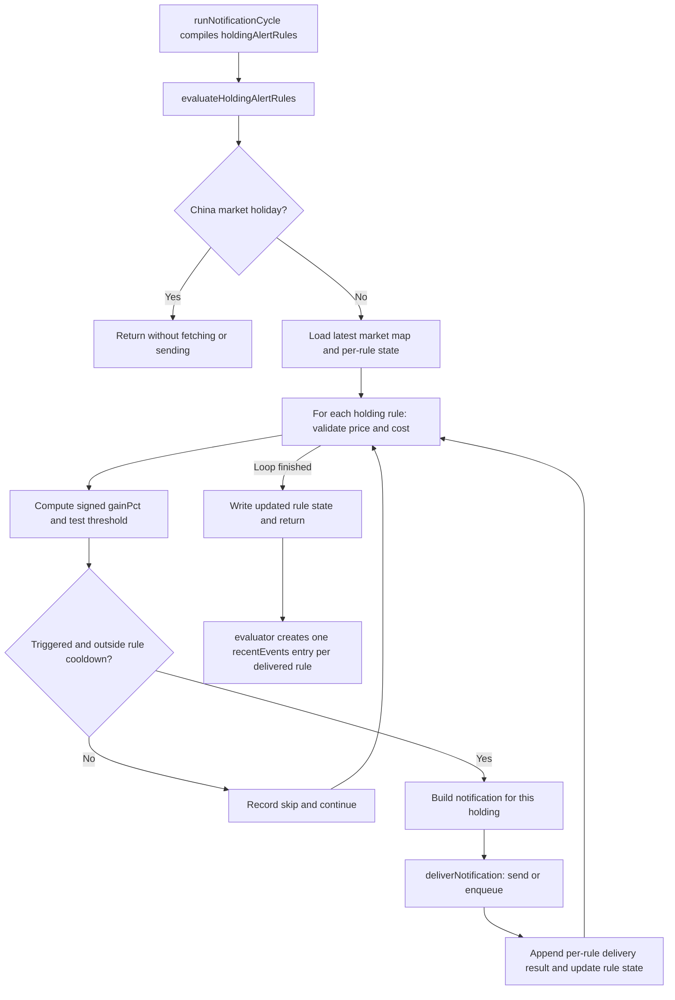

# Holding alert notification merge implementation plan

Status: proposed; this document does not implement or deploy the change.

## 1. Problem and current flow

On 2026-10-09, 28 QDII holdings triggered holding gain/loss preset alerts and produced 28 separate push notifications. A user should receive one notification for all eligible holding gains and one for all eligible holding losses in a single evaluation cycle.

The actual send happens inside `evaluateHoldingAlertRules` in `workers/notify/src/alertRuleEvaluation.js`. Changing only the event loop in `workers/notify/src/evaluator.js` would reduce log entries but leave the push storm intact.



Relevant behavior verified in the repository:

- Gain compares `gainPct >= rule.threshold`; loss compares `gainPct <= -rule.threshold`. Holding `actualValue` is signed, including negative loss values.
- Cooldown uses `prev[rule.ruleId].lastPushedAt` and `(rule.cooldownHours || 24)` hours. It skips only when elapsed time is strictly less than the cooldown.
- State lives under `ruleStates[`${clientId}:holding-alerts`]`, with original rule IDs as nested keys.
- A non-throwing delivery currently advances cooldown even if the returned channel status is failed/skipped. A thrown exception produces a per-rule `delivery-error` skip without advancing state.
- The evaluator currently rebuilds a different event ID, title and body, discards the notification's Markdown, and hardcodes event status to `delivered`.
- The holding evaluator call currently omits the cycle's `now`; the market evaluator call passes it. This should be corrected as part of making merged event IDs, event times and cooldown timestamps agree.
- `deliverNotification` can send directly or enqueue the full notification in `NOTIFY_JOBS`. Its return value contains aggregate `status` and channel `results`; queue acceptance is represented as delivered with a queue result.
- `MAX_RECENT_EVENTS` is 30. Twenty-eight per-holding entries almost fill the history window in one cycle.

## 2. Proposed scope and changes

### Grouping contract

Merge within one invocation of `evaluateHoldingAlertRules`, for one notification client/settings scope. Group by `alertType` only: `gain` and `loss`. Do not split groups by threshold, fund kind, preset ID or channel. Different clients, cycles and alert types remain separate.

Apply the grouping to all holding gain/loss rules passed to this function, including custom rules. Market alerts, daily holdings reports, position digests, sell signals and DCA notifications keep their existing behavior. There is no waiting window spanning cycles and no new group-wide cooldown.

An empty group never calls `deliverNotification`. A one-member group uses the same merged envelope as a larger group, avoiding two result schemas.

### `workers/notify/src/alertRuleEvaluation.js`

Refactor `evaluateHoldingAlertRules` into collection followed by group delivery:

1. Retain the no-rules and holiday early returns, existing market-data loading and state read. This change adds no market-data requests, cache strategy or list-page prefetch.
2. Keep price/cost validation, signed percentage calculation, threshold comparisons and per-rule cooldown checks in the rule loop.
3. For every eligible rule, append a snapshot to the appropriate bucket instead of sending immediately. Snapshot fields: `ruleId`, `symbol`, `name`, `fundKind`, `alertType`, `threshold`, `holdingCost`, `currentPrice`, signed `actualValue` and `cooldownHours`.
4. Deliver nonempty buckets in a deterministic order (`gain`, then `loss`), once each. Keep delivery sequential and isolate each group's error handling, so one group's exception does not prevent delivery of the other.
5. Set `env.__notifySettings` and `env.__notifyCurrentClientId` before group delivery, as the current function does. Reuse the same delivery engine and configured channels.
6. Preserve the returned aggregate status and the entire `result.results` array for each group. Do not create one copy of channel results per member.
7. On a non-throwing result, update every participating original rule key with its own signed value and the common cycle timestamp. On a thrown exception, record `delivery-error` for every member and leave those rule states unchanged.
8. Write `next` once after group processing when at least one group returned without throwing. Preserve unrelated state entries and all existing skip reasons.

Use an optional small pure helper module, `workers/notify/src/holdingAlertNotification.js`, for content construction, display ordering and the merged payload. Keep the network send and state orchestration in `evaluateHoldingAlertRules`; the helper must not fetch data or deliver notifications.

Proposed function return contract:

```js
{
  delivered: [
    {
      notification, // Exact merged payload passed to deliverNotification
      alertType: 'gain',
      alerts,       // Complete per-rule snapshots; also in notification.alerts
      status: result.status,
      results: result.results || []
    }
  ],
  skipped: [ /* existing per-rule skip objects */ ]
}
```

`delivered` remains the existing property name for compatibility. It contains one entry per non-throwing group delivery attempt, rather than one entry per rule. Its name is not evidence of successful delivery; consumers must use `status` and `results`. The evaluator and existing holding unit test are known consumers and must be updated together.

### `workers/notify/src/evaluator.js`

In the holding-alert branch of `runNotificationCycle`:

- Pass the existing cycle `now` to `evaluateHoldingAlertRules`.
- Replace the per-holding event builder with one event per group result. Copy the actual notification fields; do not reconstruct content or a symbol-specific action.
- Set event `id` equal to `notification.eventId`, and `channels` equal to the group's `results`. Set `status` to the delivery engine's actual aggregate status instead of hardcoding `delivered`.
- Append the merged event once to both `events` and `recentEvents`. Preserve existing `createdAt`, `reason` and legacy scalar fields.
- Keep summary counter definitions unchanged: triggered/delivered counts refer to events, so 28 holding gains become one holding event. Compiled rule counts still count rules. `holdingCount` and `alertCount` explain how many holdings/rules a merged event represents.
- Do not feed group results through a per-member failure-counter loop. Holding alerts currently do not invoke `updateDeliveryFailures`; adding automatic channel removal is outside this change.

### Links and detail consumers

Build the action with the existing helper:

```js
buildNotificationDetailAction(env, 'holdings', '', {
  trigger: 'holding-alert',
  alertType
})
```

The default gain link becomes:

```text
https://freebacktrack.tech/index.html?tab=holdings&source=notification&trigger=holding-alert&alertType=gain
```

Carry through `detailUrl`, `url`, `links`, `target` and `params`. Do not include `code` or an individual `ruleId`, even for a single-member merged notification. Existing environment overrides still apply.

`src/pages/NotifyEventDetailDialog.jsx` currently displays `body` and supports copying the event JSON; it does not render `body_md` or a structured holdings table. Keeping every symbol and signed percentage in `body` makes them visible immediately. Preserve complete `alerts` snapshots and detailed Markdown in event data for detail consumers and exports. A new interactive holdings table is unnecessary for this worker change; if later added, it must retain the legacy-event fallback and follow the mobile bottom-sheet navigation rule in `AGENTS.md`.

`notifyRowStorage.js` stores whole event objects as the event row's `value`, so additive fields should survive without a schema migration. Verify the round trip and status/event APIs rather than introducing a new storage system.

## 3. Notification formats

Use a threshold-neutral title by default. Holdings in the same group may have different thresholds, so a common threshold must not be implied.

| Group | Title | Plain-text body example |
| --- | --- | --- |
| Five gains | `持仓涨幅预警（5只）` | `006479 +5.64%, 008971 +4.21%, 021000 +3.80%, 513100 +3.12%, 159655 +2.30% → 点此查看持仓。` |
| Three losses | `持仓跌幅预警（3只）` | `006479 -5.64%, 008971 -4.21%, 021000 -3.80% → 点此查看持仓。` |
| One gain | `持仓涨幅预警（1只）` | `006479 +5.64% → 点此查看持仓。` |

If all members have exactly the same threshold, an optional equivalent title is `5 只持仓盈利达到 2%` or `3 只持仓亏损达到 2%`. Prefer “达到” to “超过” because equality triggers the rule. The default neutral title is sufficient for the first implementation.

Formatting rules:

- Format percentages to two decimals, with an explicit `+` for gains and `-` for losses. Keep unrounded numeric values in event snapshots and state.
- Sort gains by descending signed percentage and losses by ascending signed percentage, then symbol and rule ID for stable ties. Use the same ordering in body, Markdown and snapshots.
- Count distinct symbols for the title's `holdingCount`; separately preserve `alertCount` for eligible rules. Suppress duplicate input entries with the same `ruleId` before collection to avoid duplicate rows/state handling.
- If multiple rules for the same symbol evaluate to the same percentage and cost, display that holding once in plain text but keep all rule snapshots. If costs differ, show the symbol's evaluated percentages with their costs, rather than arbitrarily dropping an evaluation.
- List every holding in the constructed body; do not silently limit it to the first few members or send overflow notifications. Names are omitted from the compact body to keep the 28-holding scenario short. The Markdown contains all names and details.
- Escape Markdown control characters in names/symbols, and normalize line breaks in user-provided names.

Example `body_md`:

```markdown
**持仓涨幅预警（2只）**

| 标的 | 名称 | 持仓收益 | 触发阈值 | 当前价 | 持仓成本 |
| --- | --- | --- | --- | --- | --- |
| 006479 | 广发纳斯达克100ETF联接人民币(QDII)C | +5.64% | 2.0% | ¥1.056 | ¥1.000 |
| 008971 | 示例持仓 | +4.21% | 3.0% | ¥1.042 | ¥1.000 |

点此查看持仓。
```

The prices above are illustrative formatted values; calculations must use full precision. Existing adapters receive the same notification: Bark uses plain body, Server酱³ uses Markdown plus its own short preview, and WebSocket carries the structured payload. A short channel preview or collapsed OS banner may not show the entire list; the full submitted body, event data and detail view must retain it.

## 4. Merged notification and event structure

Retain `eventType: 'holding-alert'`. Add `merged`, `alertType`, `holdingCount`, `alertCount`, `ruleIds`, `symbols` and `alerts`. Preserve scalar keys with a stable group identity and an empty symbol instead of inventing a comma-separated scalar symbol.

Generate one ID per group using the cycle timestamp and a bounded stable client-scope token:

```text
holding-alert:merged:gain:<nowMs>:<clientScopeToken>
holding-alert:merged:loss:<nowMs>:<clientScopeToken>
```

The token should be derived deterministically from `clientId` (for example a short SHA-256 prefix) and keep the entire ID below the delivery queue's 120-character ID-input limit. Including client scope prevents same-millisecond events for different clients from colliding in owner-scoped delivery records. A timestamp ID alone is not an atomic deduplication mechanism.

Example stored event (one member shown to illustrate the schema):

```js
{
  id: 'holding-alert:merged:gain:<nowMs>:<clientScopeToken>',
  eventType: 'holding-alert',
  ruleId: 'holding-alert:merged:gain',
  symbol: '',
  merged: true,
  alertType: 'gain',
  holdingCount: 1,
  alertCount: 1,
  ruleIds: ['holding-alert:preset:gain:006479'],
  symbols: ['006479'],
  alerts: [{
    ruleId: 'holding-alert:preset:gain:006479',
    symbol: '006479',
    name: '广发纳斯达克100ETF联接人民币(QDII)C',
    fundKind: 'qdii',
    alertType: 'gain',
    threshold: 2,
    actualValue: 5.64,
    currentPrice: 1.0564,
    holdingCost: 1,
    cooldownHours: 24
  }],
  title: '持仓涨幅预警（1只）',
  summary: '持仓涨幅预警（1只）',
  body: '006479 +5.64% → 点此查看持仓。',
  body_md: '...complete per-holding Markdown...',
  strategyName: '',
  triggerCondition: '',
  purchaseAmount: '',
  detailUrl: '...holdings page URL...',
  url: '...same URL...',
  links: { web: '...same URL...', app: '', miniProgram: '' },
  target: 'holdings',
  params: { trigger: 'holding-alert', alertType: 'gain' },
  status: 'delivered', // Copy actual aggregate delivery status
  channels: [ /* Unmodified group result.results objects */ ],
  createdAt: '...cycle timestamp in ISO format...',
  reason: 'scheduled'
}
```

The notification uses `eventId` where the persisted event uses `id`; their values must be identical. Include the additive snapshot fields in the notification too, so queue and WebSocket delivery retain the same data.

Compatibility policy:

- Existing single-holding events remain readable and are not rewritten. Consumers feature-detect `merged`/`alerts` and keep the old scalar-field fallback.
- Group `ruleId` is a presentation identity, never a cooldown state key. Original rule IDs remain in `ruleIds` and `alerts`.
- There is no meaningful group-level numeric `actualValue` or common threshold when rules differ; these remain per-member fields.
- Preserve channel result metadata such as `channel`, `status`, `detail`, `configKey`, `configId`, `configType` and `configLabel` exactly once per group.
- A group with partial channel success uses the delivery engine's aggregate status and retains failed channel results. Queue acceptance describes enqueueing, not confirmed receipt by every device.

## 5. Cooldown and error strategy

Use the existing per-rule state namespace and default cooldown. There is no state migration and no reset on deployment.

| Situation | Delivery | State action |
| --- | --- | --- |
| Below threshold, missing data or invalid price/cost | Exclude rule from group | Preserve rule state |
| Triggered but elapsed time is less than its cooldown | Exclude rule; retain `debounced` skip | Preserve rule state |
| Eligible group returns without throwing | One delivery attempt for group | Set each member's `lastPushedAt = nowMs` and its own signed `lastPushedValue` |
| Group throws | Record `delivery-error` for each member; continue other group | Preserve failed group's rule state |
| At exact cooldown expiry | Include qualifying rule | Advance state after non-throwing attempt |

Preserve the current non-throwing-result policy, including failed/skipped channel outcomes, to avoid changing retry frequency in a push-volume fix. Log those statuses accurately. A success-only cooldown policy would be a separate behavior change requiring retry/backoff design; it must not be introduced accidentally here.

Example: cycle A sends one gain notification for rules A–E and advances all five rule timestamps. During cooldown, A–C still qualify, D–E no longer qualify, and newly eligible rules F–G qualify. Cycle B skips A–C as debounced, omits D–E, and sends one notification for F–G. It does not resend A–C and does not block F–G behind a group cooldown.

Different cooldown durations are evaluated independently. Gains and losses retain separate rule identities and are grouped only after eligibility checks. Never write `lastPushedAt` under the synthetic merged `ruleId`.

Existing limits remain: overlapping invocations can read the same state before either persists it, and a crash after send/enqueue but before state persistence can allow a repeat. This plan preserves sequential persisted-state cooldown guarantees; it does not claim exactly-once delivery under concurrency. Review existing scheduling/queue behavior during rollout. If concurrent-cycle duplicates are observed, address them with an explicit client-scoped claim/serialization mechanism and tests, rather than relying on a timestamp ID or adding a global cooldown that suppresses newly eligible holdings.

## 6. Test plan

Tests must count real delivery-boundary calls, not only event entries. Prefer fake `MARKETS.fetch` plus a capturing `NOTIFY_JOBS.send` with account-owned settings to inspect complete notification payloads. Also test a direct channel with a mocked transport. Do not contact live endpoints.

### Update existing coverage

- `test/notifyPriceAlerts.test.mjs`: update the single-holding test to assert `notification`, `alerts`, signed value, holdings-page link and original state key. Supply an explicit nonholiday `now`; the existing test depends on wall-clock date. Keep existing market-alert expectations intact.
- `test/notificationLinks.test.mjs`: add merged holdings navigation assertions, including configured base URL, no `code`/individual rule ID, and identical `url`, `detailUrl` and `links.web`.
- `workers/notify/test/tradingCalendar.test.mjs`: retain the holiday no-fetch behavior and additionally assert no delivery and no state write.
- `test/notifyRowStorage.test.mjs`: round-trip a merged event with nested snapshots and channel metadata, alongside a legacy event.

### Add focused holding merge coverage

Add `test/notifyHoldingAlertMerge.test.mjs` (and helper tests if the helper is extracted):

1. **28 QDII gains:** one send/enqueue, one merged payload, all 28 symbol/value pairs, full snapshots, and all 28 original cooldown entries updated. Assert no per-holding send loop survives.
2. **Multiple losses:** one loss delivery with negative signed values in body, snapshots and state.
3. **Mixed gain/loss:** exactly two deliveries/events; no cross-type members.
4. **One member and mixed thresholds:** uniform envelope; mixed thresholds still produce one group and a truthful neutral title; each snapshot retains its threshold.
5. **Nothing eligible:** no delivery or state write for untriggered rules, all-debounced rules or missing/invalid data. Preserve skip reasons.
6. **Threshold boundaries:** exact positive/negative thresholds trigger; calculations use unrounded values. Invalid price/cost rules never appear in the group.
7. **Cooldown:** preserve seeded legacy state, suppress a repeated cycle, allow expiry at the exact boundary, handle mixed durations/default 24 hours, and preserve unrelated state keys.
8. **Changed membership:** exercise A–E followed by A–C plus F–G; only F–G deliver in cycle B. Include a rule falling below threshold and rising again inside its original cooldown.
9. **Errors and statuses:** an enqueue exception leaves every group member unchanged and does not prevent the other group's delivery. Test non-throwing failed/skipped outcomes and partial channel success to lock down the existing state policy and accurate returned status/results.
10. **Identity and formatting:** event types differ, client scopes produce different bounded IDs for the same time, event and notification IDs agree, sorting/signs are deterministic, Markdown names are escaped, duplicate rule IDs do not duplicate members, and multiple thresholds/costs for a symbol retain every rule snapshot.
11. **Direct channel:** multiple holdings cause one mocked Bark request with the merged body and holdings URL; verify loss separately. Confirm full Markdown through the existing Server酱³ payload builder.
12. **Request boundary:** merging adds no per-holding quote, K-line, financial, NAV-history or AI-summary requests. Use the existing batched market-metrics route and preserve its refresh behavior.

### Evaluator integration

Add `test/notifyHoldingAlertMergeCycle.test.mjs` around `runNotificationCycle`, with a fixed cycle clock through the project's test clock facilities or a controlled `Date` stub, restored after each test:

- A holding-only payload with 28 eligible gains yields one send, one `summary.events` entry and one additional `recentEvents` entry, containing all snapshots and channel results.
- Gain and loss yield two group events; compiled holding rule counts remain unchanged.
- Notification/event title, body, Markdown, URL and IDs agree. Assert the cycle timestamp reaches the holding evaluator and all member states.
- A follow-up cycle with persisted state produces zero duplicate holding notifications within cooldown.
- Status reflects failed/skipped/partial results rather than the old hardcoded success. A failed returned result does not increment `deliveredCount`.
- Existing recent events remain available within the 30-entry cap; a merged group consumes one slot.
- Status/event storage round trips expose the complete `alerts` data; a legacy single-holding event still displays through the existing detail dialog. Verify the full list in the detail dialog manually or with a suitable UI test if its rendering changes.

Required implementation validation commands:

```bash
node --test test/notifyPriceAlerts.test.mjs test/notifyHoldingAlertMerge.test.mjs test/notifyHoldingAlertMergeCycle.test.mjs test/notifyRules.test.mjs test/notifyPresets.test.mjs test/notificationLinks.test.mjs test/notifyRowStorage.test.mjs test/notifyDeliveryTargetChannels.test.mjs workers/notify/test/tradingCalendar.test.mjs
npm run check:refactor
npm run lint -- --quiet
git diff --check
```

The new test filenames above are planned additions. For this document-only change, run the relevant existing tests and repository checks; those results do not validate an unimplemented merge.

## 7. Rollout considerations and risks

Implementation sequence:

1. Define and test the pure merged payload/content contract.
2. Change collection/delivery and state updates in the holding evaluator.
3. Update its event consumer in the same change, including passing `now` and preserving actual statuses.
4. Add integration/storage coverage and run all required checks.
5. Review a captured 28-holding fixture and one mixed gain/loss fixture before deploying. Use fake channels or a test account for delivery review.
6. Deploy the notify worker through the normal release process. No historical event or cooldown migration is needed. Frontend changes are needed only if inspection reveals a consumer that cannot accept the additive envelope.
7. Observe the first scheduled cycles: eligible rule count, group count, actual outbound request/queue count, event count, debounced count and delivery errors. Monitor counts without logging private holding snapshots unnecessarily.

| Risk | Mitigation / rollout check |
| --- | --- |
| Log aggregation masks continued individual sends | Test and inspect delivery-boundary call counts; the merge occurs before `deliverNotification` |
| Long notification bodies or transport payload limits | Exercise 28 holdings and the supported maximum rule payload through existing adapters/queue; inspect encoded byte size and channel behavior. Do not introduce overflow pushes or silently drop members. A documented channel limit discovered here must be resolved before release |
| Mixed thresholds produce misleading wording | Use neutral group title; retain per-rule threshold in Markdown and snapshots |
| Consumer assumes one scalar symbol/rule per event | Preserve legacy keys, add arrays, inspect status/detail consumers and round-trip storage; keep historical-event fallback |
| Cooldown reset or suppression of newly eligible holdings | Keep original nested state keys; no synthetic group state or group-wide debounce |
| Delivery result loss or misleading success | Copy aggregate status and full results; queue acceptance remains distinct from device receipt in channel details |
| Partial delivery causes accidental resends | Preserve current cooldown policy; do not retry the whole group within cooldown after a non-throwing result |
| Event-ID collision across clients or truncation | Include a bounded client-scope token and verify length/identity in tests |
| Concurrent/crashed cycles duplicate pushes | Preserve existing guarantees, inspect scheduling overlap, and track repeats; atomic claims are a separate reliability change if required |
| Rollback restores push storms | Roll back evaluator and caller together; retained per-rule state remains compatible, but eligible alerts return to per-holding pushes |

Do not clear cooldown state for a production smoke test, manually replay the October 9 alerts, or deploy as part of this planning task.

## 8. Acceptance criteria

- [ ] Twenty-eight eligible QDII holding gains in one client cycle cause exactly one holding gain notification per configured delivery channel, or one queued notification job for channel fan-out.
- [ ] Holding losses merge the same way; a mixed cycle produces one gain group and one loss group at most.
- [ ] Title accurately counts holdings, and constructed plain body lists every symbol with its signed percentage; Markdown and snapshots retain complete per-rule details.
- [ ] Different thresholds do not split a same-type group or misstate a common threshold.
- [ ] Merged links open the holdings page without selecting an individual symbol or rule.
- [ ] One merged event is recorded per non-throwing group attempt, using the notification's exact ID/content, actual aggregate status and unmodified channel results.
- [ ] Existing event keys/types and historical single-holding event rendering remain compatible; new snapshot fields survive persistence and status/event API reads.
- [ ] Every delivered-attempt member updates its original per-rule cooldown state; skipped or exception-failed members retain theirs. Stored loss values stay negative.
- [ ] Repeated sequential evaluations with persisted state do not resend cooled-down members, while newly eligible members can produce a new merged notification.
- [ ] A group's exception cannot prevent the other alert type from being processed.
- [ ] The cycle clock is used consistently for holding eligibility, event ID, cooldown state and event creation time.
- [ ] The change introduces no new market-data fetches, detail-level prefetch, cache keys or source-concurrency changes.
- [ ] Delivery-boundary, cooldown, error/status, event/storage and existing market-alert/holiday tests pass, along with refactor guard, lint and diff checks.
