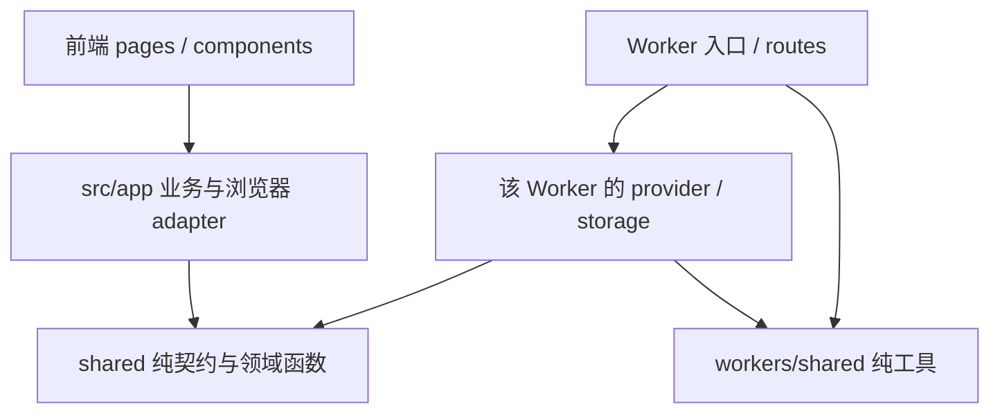

# ai-dca 保守重构计划

> 状态：待审阅的计划，尚未实施。分析日期：2026-10-09（UTC）。
> 分支：`work-holiday-main`；基线提交：`b37bdb98038fad6902660d331ddab6943349892e`。
> 本次交付仅新增本文档。下文的拟改文件、测试和上线步骤均属于后续实施，不表示已经执行或获准发布。

## 1. 范围、依据与不可变约束

本计划采用小步、可独立回滚的行为保持重构：先整理文档和确定的遗留代码，再抽取纯函数、拆分前端展示和行情适配器，最后才考虑计算、同步和通知等高风险模块。禁止把缓存纠偏、数据源切换或功能下线混入模块搬迁。

已读取的主要依据：

- 仓库 [AGENTS.md](../AGENTS.md)：列表/详情请求边界、缓存优先级、基金字段口径、并发与测试要求。
- 仓库 [CLAUDE.md](../CLAUDE.md) 和大小写不同的 `AGENTS.MD`：整洁性、测试目录、拆分与浮层规范。后两者当前内容完全相同；不能把 `AGENTS.MD` 当作另一个应保留的指导文件。
- 工作区 `/home/hatch/AGENTS.md` 和 `/home/hatch/MEMORY.md` 的 ai-dca 相关条目：Codex 规划、Codely 实现；根目录 Markdown 限制；fast 站验收；本地认证、通知生产分支和采集器切换限制。仓库内没有 MEMORY 文档。MEMORY 是带日期的运行记录，不能代替当前线上状态核实。
- [已有重构记录](archive/plans/project-maintainability-refactor-plan.md)、[通知部署记录](ops/notify-worker-deploy.md)、[实时通道架构](architecture/realtime-channel.md)、[QDII 净值规则](reference/qdii-nav-rules.md)、[数据词汇表](reference/data-glossary.md)。历史记录中的文件数、部署入口和完成状态以本次代码检查为准。
- `package.json`、`eslint.config.js`、`vite.config.js`、`playwright.config.js`、`scripts/check_refactor_guard.mjs`、各 Worker 的 `wrangler.toml` 及主要运行入口。

必须遵守：

1. 仓库根目录只保留 `README.md`、`CLAUDE.md`、`AGENTS.md` 三份 Markdown 文档。这是文档限制，**不删除** `package.json`、锁文件、构建配置、`index.html` 等必要工程文件。本文按本次明确要求使用 `docs/plan-refactor.md`，覆盖旧的通用计划命名约定。
2. 后续每个阶段按固定流程执行：Codex 给出具体计划与验收标准 → Codely 实现 → 审查 diff → 相关 Node 测试 → refactor guard → lint → diff 检查 → 必要的构建/浏览器验证 → 经确认的发布和 fast 站验收。实际 Bug 另走同一流程，不借重构绕过。
3. 不改变生产数据源、域名、API 路由、Worker `main`、服务绑定、KV/R2/D1/SQLite/TiDB 路径、存储 key/version、cron、队列、通知渠道或投递路径。生产采集器和通知链路未获批准不得切换。
4. 不改变可见 UI、深链接、历史 URL 重定向、持仓/收益/回测算法、金额舍入、默认参数、错误文案、鉴权和降级语义。`null`、`0`、空串、缺失字段不能互相替代。
5. 列表继续由 `useVisibleMarketSymbols` 和当前 active list 决定范围；隐藏列不得产生增强请求。详情重数据仅在用户选择标的、打开对应能力后按需加载。没有数据源的模块在前端本地短路，不请求固定空接口；禁止新增后台预取。
6. 缓存保持最近层优先：组件 inflight/memory → localStorage 列表增强 → Worker KV 小对象 → 详情按需 R2 大对象 → 源站。既有 IndexedDB 历史缓存保留；不能为了列表缺字段同步回源、读取 R2 完整序列或增加重接口兜底。
7. 场内高点来自 1d K 线派生的 `highPoint` / `yearHigh` 小元数据；CN 场内缺缓存显示 `—`，不用 quote 的 `high52w` / `highest` 兜底。场外可用 quote 不再触发 NAV 快照；限额只服务正在展示的场外列表。
8. 保留批量数量上限、`mapLimit` 并发上限、live fetch 后原缓存写入和显式刷新入口。拆分不能扩大 `forceRefresh` / `forceLive` 的调用范围。

## 2. 现状分析

### 2.1 规模与目录组织

以下统计基于 `git ls-files`，排除未跟踪/忽略产物；源码行数为物理行数，包含空行、注释和对应目录中的测试/脚本，不等同于有效代码行数。

| 范围 | 跟踪文件 | 代码文件 | 物理行数 | 说明 |
| --- | ---: | ---: | ---: | --- |
| 全仓库 | 688 | — | — | 根目录 19 个文件，另有 docs/public 等 |
| `src/` | 293 | 293 | 62,999 | 290 个 JS/JSX，3 个 CSS |
| `workers/` | 159 | 128 | 29,553 | JS/MJS/TS/Python，含 4 份 Node 测试 |
| `scripts/` | 15 | 14 | 2,341 | 另有 1 个 Shell 脚本 |
| `test/` | 100 | 100 | 13,772 | 84 份 Node 测试；15 份 E2E spec 和 1 个 helper |
| `docs/` | 92 | — | — | 架构、运维、参考、归档、原型与站点资源混合 |
| `public/` | 9 | — | — | 发布源资源，部分复制到 docs |
| `services/` | 0 | 0 | 0 | 此分支没有跟踪的本地服务源码；不能据此判断生产未使用 |

```text
src/
  entry-screen.jsx       React StrictMode 入口、延迟启动、实时通知挂接
  pages/                 115 文件；主页面及 markets/holdings/notify 拆分模块
  app/                   118 文件；业务计算、存储、API、同步、backtest/、income/
  components/            53 文件；通用 UI、data-table/、markets/ 回测与图表
  hooks/                 useClickOutside
  lib/                   UI 工具
  styles/                3 个样式文件
workers/
  markets/               行情/API/cache/providers，约 6,188 行代码
  notify/                账户和设备兼容、规则、投递、队列、WS，约 14,900 行
  ocr-proxy/             OCR、持仓 NAV、历史 NAV、基金限额/费率，约 4,152 行
  sync/                  账户、加密备份、版本、分析事件，约 1,444 行
  market-collector/      独立采集器、交易日历和对比脚本，约 870 行
  markets-agent/         TS Worker + Node Container + 动态 skill，约 1,563 行
  user-data/             D1 身份 + Hyperdrive/TiDB 业务存储，375 行
  geo/                   地区识别，52 行
  apex-redirect/         旧域名重定向，9 行
scripts/                 发布、知识库、分析、诊断和人工维护
test/                    Node 测试与 test/e2e
docs/                    长期文档、archive、mockups 和部分发布资源
public/                  静态资源的源目录
```

目录不是完全未分层的单体：markets、holdings、notify 已抽取多批模块，`syncRegistry.js` 已集中同步白名单/合并策略，`marketCacheKeys.js` 已集中一部分浏览器缓存 key。后续应延续这些边界，避免重新建设一套并行机制。

依赖也分成多个安装/打包单元：根包声明 React 19、Vite 5，以及 Radix、TanStack Table、Recharts、Tailwind 等 UI 依赖；加密模块使用 tweetnacl。`markets-agent` 单独声明 TypeScript、Wrangler 4 和 `@cloudflare/containers`；Container 独立 package/Dockerfile；`user-data` 单独声明 mysql2。cn 的 auth 服务要求 Node ≥22.5，使用原生 SQLite。没有根级 npm workspace 统一这些单元，不能认为根 `npm install` 或 Vite build 已覆盖所有后端依赖。

### 2.2 入口、依赖与运行边界

| 入口/子系统 | 当前依赖和职责 | 重构边界 |
| --- | --- | --- |
| `entry-screen.jsx` → `ScreenPage` → `WorkspacePage` | 主 tab、lazy chunk、URL/hash、账户状态、事件；首页还受本地持仓和偏好影响 | 不能按旧文档把默认首页统一改成某个 tab |
| `MarketsExperience` | 自选、搜索、可见行、刷新、WS、列表列策略、详情调度 | 重逻辑移入 `pages/markets/*` / `app/*`，保留调度职责 |
| 行情客户端 | `marketsApi`、`navService`、`navHistoryClient`、`marketHistoryCache`；`directMarketData` 仍用于直连搜索/缓存/实时兼容 | 不能把看似旧的直连模块直接删掉或改成全走 Worker |
| 持仓/收益 | `holdingsLedger*`、`holdingsHelpers`、`portfolioSeries`、`income/*`、NAV 客户端 | 本地账本、FIFO、待确认交易、跨境 NAV、累计收益独立保留 |
| 交易计划/切换 | `TradePlansExperience` lazy 加载新建、定投、卖出；`SwitchStrategyExperience`；前端回测引擎 | 旧独立页面可能遗留，但对应子视图和业务模块仍在使用 |
| `markets/src/index.js` | provider、route、runtime、KV、R2、cron；绑定内部 AGENT 服务 | API façade 保留，来源优先级和 fallback 不因搬迁改变 |
| `notify/src/accountEntry.js` | **wrangler 的实际入口**；包裹 `index.js`，负责账户鉴权、快捷路由、queue、outbox、定时切换 | 不能只审查/测试 `index.js`，也不能改回旧入口 |
| `sync/src/index.js` | D1 身份/分析/加密备份，KV 镜像和兼容回填 | 备份读取可能带惰性回填；验证应使用隔离数据 |
| `user-data/src/index.js` | `mysql2/promise`；D1 会话校验；Hyperdrive/TiDB | 与加密备份属于不同存储模型，不能合并或迁移生产数据 |
| `market-collector` | 腾讯/东财/fundmobapi；MC_KV；每分钟 cron；对比 CN 源 | MEMORY 明确暂不切换 notify 源；`FORCE_COLLECT` 和 shadow 路径保留 |
| `markets-agent` | Container 启动 Node server，skill.json 动态发现并 spawn 执行 | 静态 import 不可达不代表动态 skill 未使用 |

跨目录依赖的具体例子：

- `notify/notificationRuleEvaluation.js` 引用前端目录的 `src/app/strategyEngine.js`。
- OCR 的 `fundCatalog.js` / `holdingsOcrRows.js` 引用 `src/app/holdingsCore.js`，`imageOcrRoutes.js` 引用 `fundSwitchCore.js`。
- OCR 的 `fundLimit.js` / `fundLimitOverview.js` 为预设常量引用包含 localStorage 操作的 `marketsWatchlistStorage.js`。
- OCR 的 `holdingsNavRoutes.js` 和 Container skill 的 `lib/eastmoney.js` 引用 notify 的 `getNav.js`。

对 531 个 JS/JSX/MJS/TS 文件解析静态 import、字面量 dynamic import、re-export 和 Vite `@/` 别名：没有发现静态依赖环。此结论不覆盖计算出的 import、skill spawn、HTTP/service binding 或存储形成的运行依赖。`MarketsExperience`、`HoldingsExperience` 分别依赖 39、33 个本地模块，仍有较高调度耦合。

生产与分支存在明显差异：本地 `cn` 引用中能读到 `services/auth/{src,test,migrations}` 和多邮件 provider；当前工作树没有它们。已只读补查 auth 的 README、包配置、HTTP 入口和后台同步入口：它使用本地 SQLite、事务 outbox、30 天 session 和异步重试，HTTP/同步进程分别运行。生产 SQLite 路径、nginx/supervisor/cloudflared 接线和异步认证语义均不属于本计划的改造范围；不能从本分支重建或覆盖它。

### 2.3 refactor guard 的真实规则

`scripts/check_refactor_guard.mjs` 有三种约束：

1. 15 个基础抽取模块必须存在。
2. 8 个阶段以 activationFile **存在**为激活条件，再要求相关文件和更紧预算；同一个文件取基础与阶段预算的最小值。当前 8 个阶段都已激活。
3. 正则禁止旧 holdings 分支/renderer、Markets 内联 chart/detail、notify evaluator 内联消息构造、OCR 内联已拆出的 handler 等回流。

行数使用 `text.split(/\r?\n/).length`，末尾换行可能比物理行数多一行。当前有效预算如下：

| 文件 | guard 行数 | 有效上限 | 余量 |
| --- | ---: | ---: | ---: |
| `src/pages/MarketsExperience.jsx` | 1,468 | 1,520 | 52 |
| `src/pages/HoldingsExperience.jsx` | 1,250 | 1,300 | 50 |
| `src/pages/SwitchStrategyExperience.jsx` | 1,100 | 1,100 | 0 |
| `src/pages/NotifyExperience.jsx` | 49 | 880 | 831 |
| `src/pages/NewPlanExperience.jsx` | 650 | 650 | 0 |
| `workers/ocr-proxy/src/index.js` | 173 | 250 | 77 |
| `workers/markets/src/index.js` | 857 | 870 | 13 |
| `workers/notify/src/evaluator.js` | 573 | 700 | 127 |
| `workers/notify/src/index.js` | 542 | 600 | 58 |

因此 CLAUDE 中“统一 1300 行”是过时概括。guard 已通过，但存在盲区：`NotifyExperience` 变小后，职责集中到了 791 行的 `useNotifyExperience.js`；大详情面板、行情 provider、sync 入口和实际 notify 入口未受现行预算完整约束。不得删 activationFile、调高预算、压缩排版或堆进新的巨型 hook 来换取通过。

### 2.4 本次只读检查基线

环境：Node `v24.20.0`，npm `10.9.4`。当前未运行生产接口、部署、业务维护脚本、构建或 E2E；不把历史构建/浏览器记录算成本次通过。

| 检查 | 实际结果 | 含义 |
| --- | --- | --- |
| `npm run check:refactor` | 通过 | 只证明现有指定预算、必需文件和禁止模式满足 |
| `node --test test/*.test.mjs workers/*/test/*.test.mjs` | Node 汇报 520 项，509 通过、11 失败 | 六份通知相关测试文件存在基线失败；其中一份未能完成模块加载 |
| `npm run lint -- --quiet` | 失败，2 个 error | `pages/notify/useNotifyExperience.js:683` 两处 `no-useless-escape` |
| ESLint 完整诊断 | 175 个 warning | 138 个 unused-vars、35 个 effect 依赖告警、2 个无规则 ID 的告警；quiet 会隐藏它们 |
| `git diff --check`（写计划前） | 通过 | 初始工作区干净 |

失败文件已单独复现，同样为 11 项失败：

| 文件 | 失败项数 | 观测，不预判应修改代码还是测试 |
| --- | ---: | --- |
| `notifyAccountTestFallback.test.mjs` | 1 个文件加载失败 | 测试导入不存在的 `normalizeAccountNotifyTestRequest`；代码当前导出 `stripDeviceIdentityFromAccountTestRequest`，且测试要求的改写条件/URL 语义也不同，不能只换名字 |
| `notifyChannelTimeout.test.mjs` | 3 | Bark/Server酱 fetch 没有测试要求的 abort signal；超时错误文案不同 |
| `notifyDeliveryTargetChannels.test.mjs` | 1 | WS delivered 数量与期望不同 |
| `notifySettingsRoute.test.mjs` | 3 | WS 注册与 alert 同步返回 401，测试期待 200 |
| `notifyWsClient.test.mjs` | 2 | capabilities 注册结果缺失；window mock 缺少 setInterval |
| `wechatRoutes.test.mjs` | 1 | 索引 key 中未出现预期 openid 列表 |

这些是重构前已存在的失败。不得跳过/删除断言、放松鉴权、增加重复投递或补一个同名导出就宣布恢复基线。Mock 缺失、过时契约与真实 Bug 分别处理；真实行为修复须独立计划和验收。

### 2.5 主要问题清单（按严重度排序）

P0 表示实施/发布前的阻断条件，不意味着已验证线上事故；P1 表示较高维护或行为回归风险；P2 表示整洁性和一致性问题。

| 优先级 / 编号 | 证据与问题 | 处理方向 |
| --- | --- | --- |
| P0 / R01 | HEAD 提交主动删除全部 Actions workflows；README/部署文档仍称 Actions 唯一入口，`workers/README.md` 又给本地部署指令。当前代码和 MEMORY 的认证、通知分支、上游记录也不一致 | 阶段 0 冻结运行清单，阶段 1 修文档。**不自动恢复 workflows、不切分支发布、不直接 wrangler deploy** |
| P0 / R02 | 11 项 Node 失败、2 个 lint error；根 package 没有统一 Node test 命令，Vite build 不验证 Workers；现有检查不是全绿 | 先分类失败并恢复相关契约测试；敏感模块全绿前不实施其重构/发布 |
| P1 / R03 | `marketsWatchData.js` 传 `hydrateHighPoints` → `marketsApi.fetchWorkerQuotes` → `/quotes` → `attachCnExchangeHighPoint` → KV miss 时 `resolveKline*HighPointCache` 读完整 R2 K 线，偏离列表仅 KV 小元数据规则 | 单独 Bug 前置任务；本次只记录，不悄改同步补全或返回字段 |
| P1 / R04 | OTC `/quotes` 缺缓存经 `fetchOtcQuote` → `otcFundSync.fetchOtcFundFullData` 并发请求 derived、achievement、detail；列表请求承担了绩效/持仓规模详情级采集 | 单独审查哪些字段正在消费；轻量 quote 与定时/详情采集解耦另立 Bug 计划，不在抽取中删字段或换源 |
| P1 / R05 | `klineHighPointCache` 读侧主要规范化数值并补默认 source，没有显式检查 cached `source`/`updatedAt`/market-symbol 对应关系；quote、OTC、summary 等缓存校验风格不同 | 先写清各类现有契约；校验策略改变独立处理，抽取继续保留 key/TTL/source/fallback |
| P1 / R06 | guard 临界文件及其未守护的接收模块仍大：fetchers 1,749；详情 1,401；回测侧栏 1,389；列表表格 1,180；ledger core 1,113；switchStrategy 1,197；sync 989 | 阶段 4–7 按职责拆分，并将接收模块纳入预算，避免只移动体积 |
| P1 / R07 | `src/app/backtest` 与 `notify/src/backtest` 11 对文件中 7 对完全相同，4 对已经不同；前端含节假日 NAV 对齐、preparedPanel、getBar 和统计更新，Worker 副本没有完全跟进 | 先确认 Worker 副本是否仍有运行消费者；优先清理确实未用的副本，不强行合并不同算法 |
| P1 / R08 | Worker 为纯常量/解析函数依赖 `src/app`；OCR、Container 为 NAV 依赖 notify；复用方向与运行环境绑定 | 阶段 3 抽取可证明等价的纯底层；环境/存储/源站 adapter 保留各自所有权 |
| P1 / R09 | 动态 fund-backtest skill 的 `lib/eastmoney.js:4` import 跳出 Container 到 notify；Dockerfile 只 COPY `container/`，镜像中不包含该路径 | 静态确认的打包风险，尚未做镜像执行验证；作为独立 Bug，不能因静态不可达而删除 skill，也不借此更换历史 NAV 来源 |
| P1 / R10 | 已有 policy/helper 测试较多，但缺少真实 mounted effect 的请求边界验证；不少 notify 测试只调用 index.js；缺独立 user-data/Container 路由、queue/outbox 完整入口测试 | 阶段 0/4/6/7 分别补边界和失败分支；复用既有 Playwright，避免新增测试框架 |
| P2 / R11 | PostHog 封装已全部 no-op，但入口/analytics 保留调度调用、依赖与旧集成文档；回测侧栏仍定义 unused `runRotationBacktest`；notify hook 有未使用 handler/state | 阶段 2 清理确定的无效调用/局部函数；导入存在副作用时不能直接删除 |
| P2 / R12 | 前端入口不可达的旧页面有 Home、Premium、StrategyGuide、Vix、DcaCalculator 等；但 fundSwitchCore 虽前端不可达，仍被 OCR 引用；Worker backtest 与 gotify 有疑似遗留文件 | 建立运行入口、测试、动态加载和兼容 URL 证据后才删。不可达清单只是候选，不等于删除清单 |
| P2 / R13 | 根目录多出 `AGENTS.MD`、3 份分析/集成文档；两个分析脚本仍输出根目录 `DATA_ANALYSIS_REPORT.md`；Worker 局部 test、`.tmp.spec.js`、JS 维护脚本并存。QDII 文档仍说名称关键词识别，但当前 `detectQdiiByName` 只查代码白名单；实时架构文档混有已废弃 Android/FCM 设计 | 阶段 1 整理入口、输出和现状说明；文档差异先记录，不改现行算法或恢复旧通道 |
| P2 / R14 | 基金 code、kind、时间、HTTP 错误和 CORS 多种模式；交易时段边界和 16/50 等前缀口径不同；`notify/*Helpers.js` 是旧路径 re-export，非两份实现 | 只统一语义相同的部分；调用者差异保留显式 adapter。保留兼容 façade 和 guard 必需文件 |

## 3. 重构目标与验收标准

### 3.1 可验证目标

| 目标 | 验收标准 |
| --- | --- |
| 外部行为保持 | 同一固定输入/时钟下，新旧实现的输出、异常、金额精度、状态码、错误文案、存储写入和请求参数一致；只排除确实动态的时间/id。纯拆分不增加源站请求或缓存读写 |
| 明确运行边界 | 前端/Worker/Container/本地 auth 的入口和所有者有清单；shared 不引用 React、window、localStorage、具体 env binding 或任何 Worker route |
| 控制体积 | 所有现有有效预算保持或收紧；阶段 4 后 Markets ≤1,200、详情/回测侧栏/列表各 ≤700；阶段 6 后 fetchers façade ≤250、provider 单文件 ≤700；阶段 7 若执行，sync 入口 ≤500、switch façade ≤700。其他拆分目标见阶段表 |
| 防止热点转移 | 新抽取模块原则上 ≤500 行；独立且内聚的 provider/展示模块最多 700 行，需说明。将实际 notify 入口、巨型 hook 和新接收模块纳入预算；不以 minify/删换行达标 |
| 消除确定重复 | 3 份相同 mapLimit 合为一个叶子模块；相同 idle 调度、OCR 纯文本/日期函数、基金预设/无副作用契约拥有单一实现；不同算法和政策不强行合并 |
| 文档/脚本整洁 | 根 Markdown 仅 3 份；分析输出进入 docs/analytics；全量 Node 检查可从一个 npm 命令发现；常规测试不调用生产接口、不触发通知/批量写缓存 |
| 请求边界可测 | 列表可用 OTC quote：NAV 快照 0 次；隐藏列增强 0 次；ETF/指数/US 列表限额 0 次；未选详情 K 线/财务/raw/AI 0 次；快速切列表不把旧结果写到新列表；普通渲染不传强刷 |
| 缓存契约可测 | 每次涉及缓存的实现变更覆盖命中、过期、错误 source/形态、错误/空写入 key、单/批共享 key、live 写回；R03–R05 的行为纠偏按独立批准方案验收 |
| 测试质量 | 相关套件通过、无新增全量失败和 lint error；变更模块的 unused/effect 告警不增长；不调低断言或改 golden 值掩盖行为差异 |
| 回滚能力 | 每个子步骤独立提交；不做 schema/key/数据库版本迁移；能仅回退该源码提交并使用已确认的旧发布产物，无需还原业务数据 |

行数目标是完成对应阶段时的要求，不能为了达标拆出循环依赖、隐藏副作用或变更组件挂载身份。高风险阶段未执行时，保留当前预算并记录原因。

### 3.2 目标依赖方向



shared 采用现有 ESM JS 和 JSDoc，不引入全仓 TypeScript、npm workspace 或新 schema 框架。优先将引用浏览器存储文件的静态预设拆成纯数据；不把所有带“normalize”的函数替换成一个全局函数。

Container 与本地 auth 有独立打包边界，不直接依赖仓库中镜像未携带的 shared 文件；本轮默认不迁移它们。旧 module path 先 re-export，消费者渐进转移；`src/pages/notifyHistoryHelpers.js` 等 guard 必需路径保留。

## 4. 分阶段实施

每个编号下面的子步骤分别提交和验证；禁止将多个运行入口、schema、数据源或通知发送方式放进同一 PR。阶段完成再降低相关预算，失败即回退当前小步。阶段 0–3 可先完成；阶段 4/6 触及 R03–R05 时先停在展示/适配器边界；阶段 7 默认暂缓。

### 阶段 0：冻结基线与生产边界（必要前置，无业务改造）

| 步骤 | 做什么 / 拟改文件 | 风险 | 回滚 |
| --- | --- | --- | --- |
| 0.1 | 在本文或已有架构/运维文档补运行清单：branch/commit、入口、域名和 upstream、绑定、当前发布产物、通知生产所有者。只读比对本地 cn 与运行记录；确认无 workflows 后的真实发布/回滚方式 | 低；主要是把旧记录误当实时事实 | 回退文档提交；未核实项保留“待确认”，不改变运行配置 |
| 0.2 | 分类六份失败测试；对 mock 缺失和旧测试契约做单独小修。拟涉及上述六份 `test/*.test.mjs`、`test/helpers/*`；两处 lint 转义可单独处理 `useNotifyExperience.js`，保持字符串值不变 | 低至中；存在把真实 Bug 改成“测试通过”的风险 | 独立回退对应测试/lint 提交；不得修改 notify 行为来迁就断言 |
| 0.3 | 建立固定时钟的行为夹具：API、storage、source/fallback、列表缺字段、持仓/回测、通知入口。优先扩展现有相关测试；新增 `test/helpers/{memoryKv,workerEnv}.js` 等测试支持文件 | 中；错误 mock 会漏掉真实运行边界 | 回退测试提交，不改生产数据或原实现 |

验证：重跑当前全量 Node 命令、guard、quiet lint、diff check；记录分支 SHA/Node 版本和失败分类。所有受影响套件必须通过。若存在需改行为的失败，另起 Codex Bug plan → Codely 实现，作为相关阶段的依赖；不删除失败测试。单纯文档整理可先交付，敏感模块重构/发布在相应基线全绿之前暂停。

线上验收：本阶段无发布；运行清单通过已确认的部署记录/版本和 fast 站现状核对，不执行注册、回滚备份、手动采集或发送通知。“GET”也可能写惰性缓存，不把生产备份读请求当无副作用探针。

### 阶段 1：文档、脚本和检查入口整理（低风险）

| 步骤 | 做什么 / 拟改文件 | 风险 | 回滚 |
| --- | --- | --- | --- |
| 1.1 | 将 `DATA_ANALYSIS_REPORT.md`、`README_ANALYTICS.md` 迁入 `docs/analytics/`；旧 PostHog 完成/配置说明按停用现状归档；核对唯一内容后删除重复 `AGENTS.MD`；修 `README.md` / `CLAUDE.md` 的链接、目录和 guard 描述，并核对 `workers/README.md`、`docs/ops/notify-worker-deploy.md`、实时/QDII 参考文档的现状与历史边界 | 低；文档/知识库引用失效 | 单独 revert 文档移动；不改站点路由或公开 guide 资源 |
| 1.2 | 更新 `scripts/analyze-analytics.mjs` / `fetch-cf-analytics.mjs` 输出目录及帮助文本，确保目录创建和写入仅指向 docs/analytics；审查 `build_kb.mjs` 的文档发现规则，去除过时根路径引用 | 低；文件输出路径变化，属于已要求的工程整理 | revert 脚本/文档小提交；用 mock 数据验证，不真实抓取或写 Vectorize |
| 1.3 | 把当前 4 份 Worker Node 测试迁入 `test/`，文件名含 worker 前缀并更新 import；K 线 HTTP 验证脚本迁为 `scripts/smoke-kline-batch.mjs`；给 `package.json` 增加明确的 Node test 命令 | 低；漏发现测试或误把维护脚本纳入测试 | revert 移动与脚本入口；迁移前后应发现相同测试集合 |
| 1.4 | 将 `new-plan-smoke.tmp.spec.js` 正式命名并加隔离网络夹具；逐个记录 `.js` 人工维护脚本、console 粘贴脚本与 CLI 的用途，适用的 CLI 才转 `.mjs`。`add-github-secret.sh/.mjs` 先判断是否为互补入口 | 低至中；脚本调用方式或人工粘贴语义变动 | 每个脚本独立回退；不运行删除交易、改 secrets、发布或真实通知脚本 |

验证：阶段 0 的全部检查；移动后的测试数量/名称与基线一致；脚本 Node 语法检查和 mock 输出路径验证；根 Markdown 列表、大小写冲突、所有文档链接检查。`docs/asset-cache-sw.js` 与 `public/asset-cache-sw.js`、guide 资源的重复是发布复制关系，保留，不能按重复源码删除。

线上验收：运行时代码未变，不需重新部署；后续发布时核对资源/深链接仍可用。发布脚本会删除/覆盖 docs 部分内容，本阶段不更改或执行 `publish_react_pages.mjs` 的发布行为。

### 阶段 2：确定遗留代码与无效调用清理（低风险）

| 步骤 | 做什么 / 拟改文件 | 风险 | 回滚 |
| --- | --- | --- | --- |
| 2.1 | 清理 ESLint 已确认的无副作用 unused import/local/helper，例如 BacktestSidePanel 的 Trophy、`runRotationBacktest` 及其仅被该函数使用的辅助；Holdings 的 `nowIso`；详情中未消费的局部派生。逐项检查 initializer/import 是否有副作用 | 低；误删仍被闭包或计算 initializer 使用的逻辑 | 每个模块独立 revert，保留运行中算法入口 |
| 2.2 | 核对所有使用方后去掉 PostHog no-op 的 idle 调度和 analytics 桥接；拟改 `posthog.js`、`entry-screen.jsx`、`analytics.js`、`package.json`/lock、Vite 中相关 chunk 分支 | 低；其他分支或入口仍有消费者 | 先删除调用再删除封装/依赖，分别提交；回退对应提交，不升级其他依赖。保留自己的 analytics 行为 |
| 2.3 | 核实 `useNotifyExperience` 的未使用 handler/state，并联动调用者删无消费的 props/state/effect；核查 `getNav.js` 注释掉的 fetch 等明确失效注释 | 低至中；误把维护说明或事件接口当死代码 | 只删完整无消费链；无法确认的订阅/刷新不动；回退对应页面提交 |
| 2.4 | 对旧 Home/Premium/StrategyGuide/Vix/DcaCalculator 页面、gotify 和 Worker backtest 做删除候选审计：入口图 + rg 全仓引用 + scripts/skill/兼容 route + 测试 + 生产分支确认。只删除证据闭合的子树 | 中；兼容 URL、动态加载或其他部署仍引用 | 候选与实际删除分离，每个子树独立提交；旧路由 410/重定向保留，撤回删除即可 |

验证：相关 backtest、privacy、notify、tradePlans 等 Node 测试及完整检查；前端变动后本地 build + 对应 Playwright smoke，确认计划子视图和行情回测继续可达。不能把带直接 worker 引用的 `fundSwitchCore.js` 删除，也不能删除动态 fund-backtest skill。

线上验收：仅在后续获准发布后，在 fast 核查主 tab、`?tab=home/dca/quant*` 的现有重定向、交易计划各 hash 和静态 guide；不因历史页面未使用重新上线/下线任何功能。

### 阶段 3：纯函数、常量与契约去重（低至中风险）

| 步骤 | 做什么 / 拟改文件 | 风险 | 回滚 |
| --- | --- | --- | --- |
| 3.1 | 抽相同 `runWhenIdle` 到 `src/app/scheduleIdleTask.js`；收敛已证明相同的 URL/显示小工具，保留不同默认参数和日期返回格式。拟涉及入口、Workspace、siteUpdateProbe/region banner、已有 formatter | 低；启动时机或查询参数变化 | 原路径 façade/调用签名保留；revert 抽取提交，延迟/timeout 不变 |
| 3.2 | 将 fetchers:34、marketRuntime:59、fundLimit:682 的相同 `mapLimit` 抽到 `workers/shared/mapLimit.js`；将相同 OCR normalizeText/normalizeDate 抽到独立叶子模块 | 低至中；顺序、异常收集、并发上限被“优化” | 保留 `{__error}` 返回语义和输入顺序；逐 Worker 替换/回退。fetchers 不能直接 import marketRuntime，否则会引入环 |
| 3.3 | 从 `marketsWatchlistStorage.js` 提取纯预设到 `shared/marketPresets.js`，前端旧文件 re-export；OCR 只引用纯预设。为 quote/fund metric/缓存高点建立共享 JSDoc 契约；先不改 JSON 或运行校验 | 中；默认自选/version、字段可选性变动 | re-export 保持旧 API；defaults/version/key 原样，revert 不需迁移用户数据 |
| 3.4 | 将 OCR 与前端确实共用的行解析/纯 schema 移入 `shared/holdings/*`；原 `holdingsCore.js` / `fundSwitchCore.js` 保留出口；仅抽等价公共子集，算法重放不搬 | 中；宽松/严格 code 归一化、负数/零口径差异 | 小函数逐项替换，差异调用者仍使用本地 adapter；回退单次搬迁 |

验证：mapLimit 空数组、非法 limit、异常、顺序和实际并发峰值；code 输入含裸码/前缀/补零/非法值、同码场内/场外 LOF；所有既有 presets/OCR 测试；共享模块不依赖 DOM/env/源站；各 Worker 本地打包解析无环。按受影响范围运行 Node、lint、guard、diff、前端 build；新增模块纳入 ESLint/guard，Workers 不使用浏览器 globals 掩盖错误。

线上验收：获准发布后 fast 比对默认自选、基金名称、搜索、OCR 预览和现有数据展示。OCR 接口调用只在指定测试账号/隔离环境做，不保存到真实账本。

前后端重复的 `backtest/types.js` 优先提为纯 JSDoc 定义。算法副本是否删除/共享见阶段 5；交易日历先做差异表，保留上午/午休/收盘边界、节假日和 QDII 日期语义，不直接统一所有时段函数。

### 阶段 4：前端展示与页面调度拆分（中风险，先展示后 effect）

| 步骤 | 做什么 / 拟改文件 | 风险 | 回滚 |
| --- | --- | --- | --- |
| 4.1 | 拆 `MarketListTable.jsx` 的 columns/cells、view storage/presets、toolbar；拟新增同目录 `marketListColumns.jsx`、`marketTableViewState.js`、`MarketListToolbar.jsx`。表格入口 ≤700 行 | 中；列 ID、排序、pin/scroll、localStorage scope 和移动表格变化 | 列/存储/toolbar 分提交；key/version/迁移逻辑不改，revert 对应提交即可 |
| 4.2 | 拆 `MarketSymbolDetailPanel.jsx` 的 header、compare picker、指标工具条与 tab 展示；拟新增 `pages/markets/detail/*`，详情入口 ≤700 行。组件定义放模块顶层，维持挂载身份 | 中；UI 状态重置、焦点/浮层和图表尺寸变化 | 先只搬展示，数据/state 在原 owner；回退单个展示提交，保留 `useClickOutside` |
| 4.3 | 拆 `BacktestSidePanel.jsx` 的参数表单、结果区、交易记录和图表选项到 `components/markets/backtest/*`，入口 ≤700；运行/优化 orchestration 先留原处 | 中；回测参数、完整记录导出、异步完成顺序变化 | 展示与运行分 PR；保留原引擎/public helpers/完整记录，revert 展示抽取 |
| 4.4 | 将 Markets 的搜索/详情调度按边界移为 `useMarketSearch`、`useSelectedMarketData` 等；Markets ≤1,200。Holdings 的事务 UI/导入调度续拆到现有 holdings 目录，≤1,100；NewPlan ≤550，SwitchStrategy 页面 ≤900；TradePlans 展示拆到 `pages/tradePlans/*`，≤700 | 中；effect 依赖、取消/去重、URL 和账本写入时机变化 | 每个页面独立；先展示再迁移完整 effect，网络调用及取消清理成组搬迁，不重写持仓计算/通知配置 |

验证：

- 延续 `marketsWatchData`、`marketDetailDataPolicy`、`marketHighDrawdown`、`marketsWatchRefresh`、`marketsLayoutState`、holdings/tradePlans 等既有测试；不把已有 helper 测试重写一遍冒充新增覆盖。
- 扩展 `test/e2e/acceptance-helpers.js` 并新增列表请求边界 spec：拦截/计数请求；未选详情、隐藏列、US/指数/ETF 限额、可用 OTC quote 等场景断言不会调用。未知 API 不能一律 `{}` 200 掩盖错误，测试的 API 夹具按真实形态返回。
- 增加 rapid list/symbol 切换、重复 mount/StrictMode、折叠/展开、同一请求多消费者、abort 后旧结果不写入新状态测试；可见行与 active list 范围不扩张。涉及 R03/R04 的测试先展示现有缺口，行为修复独立，相关 fetch 调度抽取等待其基线确定。
- 运行受影响 Node 套件、完整检查、`npm run build:app`、已有 smoke 和对应桌面/移动 spec；核查 `?symbol`/`compare`/区间参数、hash、横屏、回测导出和空字段显示。

线上验收：经批准后 fast 逐页核对原 UI、菜单、深链接、列保存、自选切换、详情/回测与持仓读取；先观察请求日志和控制台，不触发真实通知或写真实交易。按相同数据/时段比较请求数，不把报价自然变化当回归。

### 阶段 5：业务纯计算与客户端职责分离（中至高风险，逐模块执行）

| 步骤 | 做什么 / 拟改文件 | 风险 | 回滚 |
| --- | --- | --- | --- |
| 5.1 | 从 `analytics.js` 拆 pure context/privacy、事件存储、批量发送；从 `cloudSync.js` 拆纯 snapshot/conflict/merge 到 `app/cloudSync/*`；两个 façade 各 ≤650 | 中至高；事件重复、隐私字段、冲突胜负/上传调度变化 | 保留原导出及全局监听/定时器 owner，先只抽纯函数；各子步骤 revert，无 key/密文格式迁移 |
| 5.2 | 从 `holdingsLedgerCore.js` 按 lot accounting、聚合/收益、sold lots、notify digest 拆到 `app/holdingsLedger/*`，façade ≤500，模块 ≤500；`portfolioSeries` 算法保持 | 高；FIFO、待确认交易、现金收益和成本口径改变 | 固定输入新旧输出逐字段比较；不改算法和存储，回退抽取提交 |
| 5.3 | 核实 notify backtest 无运行消费者（当前入口图未引用，quant route 返回 410）；确认后独立删除其遗留副本。若发现真实消费者，仅共享相同纯叶子模块，四个不同模块维持各自实现和差异测试；字节相同的 index 引用不同引擎，不能因此共用 façade | 中至高；误把前端新算法替换到通知/历史调用 | 删除或共享二选一，不能先批量覆盖；旧 public export/410 行为保留，revert 不需数据回填 |
| 5.4 | 拆 `marketsApi` 内部 transport/inflight 与领域调用、`directMarketData` 的 provider parser/cache，保留原出口；仅复用通用响应解析的机制，auth/notify client 用各自 adapter | 中；base override、header、retry/abort、共享 promise 取消和错误属性变化 | 逐 client 独立替换；原 `__MARKETS_API_BASE__` / `__AI_DCA_SYNC_BASE__` / VITE base 优先级不动，revert 单提交 |

验证：`analyticsPrivacy`、cloudSync conflict/merge、syncRegistry、secureVault、holdingsLedgerCore、cashYield、clearedLots、backtest-engine、marketsApi/directMarketData 等套件。补固定时钟、session/ID 注入、新旧输出对照；保留 revision/timestamp/origin tie-break、remote/local authoritative 两条不同合并语义。缓存提取必须覆盖命中/过期/source/key/write，禁止同时改 stale 或 TTL 口径。运行完整检查和本地 build/相应 UI smoke。

线上验收：fast 使用指定隔离测试账户/本地测试数据验证；普通真实账户只观察不做云端覆盖、回滚版本或数据导入。投资计算对照以固定夹具为主，线上观察只证明链路可达。

### 阶段 6：markets / OCR provider 与 route 拆分（中风险，存储政策冻结）

| 步骤 | 做什么 / 拟改文件 | 风险 | 回滚 |
| --- | --- | --- | --- |
| 6.1 | 将 `markets/fetchers.js` 拆成 `providers/{tencent,xueqiu,yahoo,danjuan,finnhub,indicators,eastmoneySearch}.js`，仍由 fetchers re-export；façade ≤250，provider ≤700。相同 host/parser 有统一 owner，不换来源优先级 | 中；cookie/header、解码、超时、字段映射和 fallback 顺序变化 | 一个 provider 一个提交；全量 export 表保持，revert 单 provider |
| 6.2 | 继续抽 `markets/index.js` 的 quote、batch quote、financials/earnings、scheduled 调度到本 Worker 路由模块，入口 ≤650。入口匹配顺序和服务绑定保持，`quoteCache`/`cnBatchQuotes` 不另建第二套 cache | 中；单/批 key、数量上限、缓存写入次数和 route 优先级变化 | 路由逐个迁移；不更改 wrangler.main、URL、KV/R2 布局、source/fallback；revert 路由提交 |
| 6.3 | 拆 OCR `fundLimit` 的公告解析、源站适配与缓存，`holdingsNavRoutes` 的纯形态处理与 HTTP orchestration；复用既有 `fundRoutes`、`ocrHttp` 出口 | 中；限额空/零/暂停口径、动态 TTL、NAV 月份缓存变化 | 先纯解析、再 adapter；原 fallback/source/TTL/key 不变，revert 单模块 |

验证：marketsSecurity、batch fallback、quoteCache、kvCache、CN warmup、Kline fallback、Tencent/Xueqiu/Yahoo、fundMetrics、fundLimitRoute/Overview、OCR NAV 等现有套件。新增 provider 契约与真实 Worker fetch 入口的 mock 测试，覆盖：批量 60 上限、并发峰值、单/批统一 key、hit/miss/expired/bad source、错误/空 key 无写入、live 写回、cache-only 不回源、列表无 candles/R2 读取、详情允许按需历史读取。

R03–R05 如需改变现有策略，在独立 Bug 完成后再用新基线验证，不借此启用 collector、更换腾讯/雪球顺序、缩短 TTL 或增加错误 toast。所有 Worker 做本地 bundle/依赖验证；前端 build 不能代替 Worker 检查。未安装 Wrangler 时使用已确认版本，不无意通过 `npx latest` 升级；agents 子项目当前要求与根 README 的 v3 描述不同，应分别处理。

线上验收：在确认该 Worker 的发布所有者/版本后，经批准发布并在 fast 对照列表/详情、NAV、缓存 hit/降级和源标识。观察请求耗时、5xx、源站次数、KV/R2 访问是否高于同类基线；出现新错误或请求膨胀回滚代码，不清空缓存。

### 阶段 7：sync / notify / NAV 的内部拆分（高风险，默认暂缓）

只有运行清单已核实、相关基线全绿、前面阶段稳定且得到此阶段实施/发布授权后才进入。生产通知拥有跨分支、账户/设备兼容、队列与幂等写入，本阶段不能与行情/UI 同时发布。

| 步骤 | 做什么 / 拟改文件 | 风险 | 回滚 |
| --- | --- | --- | --- |
| 7.1 | 将 `sync/index.js` 拆 `auth`、`backupRoutes`、`analyticsRoutes`、`schema` 内部模块，入口 ≤500；先 pure analytics formatter，再路由。ensureSchema 的 SQL、时机与兼容回填原样 | 高；身份/backup version/CAS/checksum/惰性迁移改变 | 一类路由一提交；不迁移 D1/KV、不改盐/会话/hash/存储模型；revert 后旧实现仍能读原数据 |
| 7.2 | 拆 `notify/switchStrategy.js` 的 config normalization、pure snapshot/trigger、presentation，façade ≤700；`getNav.js` 划清历史序列与实时快照职责，仅内部抽取 | 高；QDII 日历、触发次数、价格/NAV 时点和消息变动 | 原导出/默认值/触发计数/消息保留；每类纯逻辑单独 revert |
| 7.3 | 将 `accountEntry.js` 的密集 fetch dispatch、queue dispatch、scheduled dispatch 拆成可测模块；必要时拆 `notifyRowStorage` 的纯 row mapping，保留 D1/KV 兼容层 | 很高；账户校验、重绑、queue ack/retry、outbox 去重、投递扇出变化 | 保持 main=accountEntry 和原调用顺序，禁止删除 index fallback；一个入口一种 dispatch 一次提交，回退无需恢复业务数据 |

验证：从实际 accountEntry 测 `fetch`、`queue`、`scheduled` 三个入口，而非仅 index helper；覆盖账户/设备身份、secret/token、channel rebind/delete、离线 WS 的 queued、provider delivered/failed、重复 queue 消费、outbox recovery、claim 幂等、每交易日上限、cron 精确分派。测试中断言渠道调用次数与内容、ack/retry 次数、D1/KV key 和写入顺序；不以 queued 冒充 delivered。

sync 运行其 backup/analytics/鉴权完整套件：损坏密文 409、版本冲突、重复上传 unchanged、KV legacy 回填与 checksum；明确 DDL 和回填行为没有新增。NAV 使用现有 QDII/节假日/跨境数据夹具；Container 与本地认证代码继续排除在此阶段。

线上验收：经单独批准后 fast 指定测试账号验证账户界面与只读事件；真实 test notification 只发到明确指定的测试渠道，一次操作严格核对一次预期投递。不运行 admin 全量推送、不改 cron、不触发真实切换。观察自然定时周期至少覆盖一次晚盘和一个交易日；回滚版本经阶段 0 核实，outbox/队列/历史数据保持原样，不用清库消除重复。

## 5. 测试覆盖补强清单

以下是实施所需的有效缺口，已有覆盖继续复用。没有正式运行覆盖率工具，不能宣称某个比例；“无直接 test import”也不等于完全未被间接覆盖。

| 边界 | 现有基础 | 需要补的行为证据 |
| --- | --- | --- |
| 列表请求 | marketsWatchData、marketDetailDataPolicy、watchRefresh、fundLimitOverview | mounted 页面计数：隐藏列、切市场/列表、StrictMode、快速切换、未选详情；R03 的开启高点列仍不得读取 R2 在独立纠偏后验收 |
| 高点小缓存 | klineHighPoint、marketHighDrawdown | 错 source/形态、updatedAt 过期与 key 对应、错误 market/interval、禁止错误 key 写入；当前测试允许显式 hydrate，不证明列表接线安全 |
| 单/批 quote | quoteCache、batchFallback、warmup 已测不少 hit/expired/source/空 key | 裸码/带前缀别名、US/CN/OTC、cache-only、实时推送混入、source 保留、实际写入次数；不假设不同 key 语义必须统一 |
| HTTP/client | authClient、marketsApi、notifySync | 不同 base override/header/status/error.data 保持；abort 释放与多消费者共享 inflight；请求重试次数不扩大 |
| 业务计算 | ledger/backtest/cloudSync/cashYield 已有较厚测试 | 公共模块抽取的固定输入新旧比较、LOF kind 区分、待确认交易、精度尾差、缺 NAV、节假日、revision tie-break |
| notify | index/routes/channel/helper 测试及 reliability | accountEntry 的 fetch+queue+scheduled 联动、身份/兼容分派、重复消费/半失败、幂等与 queued/delivered 区分；先处理 11 项基线失败 |
| user-data | 此分支未发现专属 Node 测试 | 身份无效/缺 Hyperdrive、记录版本冲突和 tombstone；仅隔离 mock DB，业务存储迁移仍 out of scope |
| Container | 静态入口和 skill 清单 | 镜像内动态 skill import/执行、缺依赖、超时/stdout JSON/SSE 取消；R09 先独立 Bug，不能用仓库本地 import 成功代替容器成功 |
| 本地 auth | cn 分支自带 auth/outbox/server 测试 | 在其生产代码来源确认后的独立任务验证异步同步去重、session 重放不延长；本轮不迁移其测试/服务 |
| 发布/静态资源 | assetCacheServiceWorker、siteUpdateProbe、regionEnvironment | 使用已批准发布机制验证旧 lazy chunk、404 深链接、资源源目录/复制关系；不在重构恢复被删除的 workflows |

不为纯文件移动编写镜像实现的测试；新测试集中在调用次数、缓存副作用、公开返回、并发/取消、账本计算和投递幂等等真正容易回归的边界。

## 6. 每阶段共同验证与发布/回滚方式

当前基线命令（Worker 测试未归位前）：

```bash
node --test test/*.test.mjs workers/*/test/*.test.mjs
npm run check:refactor
npm run lint -- --quiet
git diff --check
```

测试归位后的统一命令应与 `node --test test/*.test.mjs` 发现同一集合。涉及前端再运行 `npm run build:app` 和对应 Playwright；例：

```bash
npm run test:e2e:smoke
npx playwright test test/e2e/watchlist-otc-defaults.spec.js --project=chromium
npx playwright test test/e2e/markets-otc-compare.spec.js --project=chromium
```

以上构建/E2E 示例是未来实施检查，本次未执行。不执行 publish、kb:build、维护删除、force collect、通知 run/test 等带真实副作用的脚本。E2E 使用独立浏览器 profile 和 mock/测试账户；`PLAYWRIGHT_BASE_URL` 远程验收不要顺便触发生产写入。

发布前检查变更文件没有 wrangler binding/main/cron、源站默认 URL、存储 prefix/version、SQL/schema、通知渠道及数据迁移变化；只收紧已完成拆分的 guard，不能全局开启严规则后顺带格式化全仓。新 shared/Worker 文件逐步纳入适用的 lint，现有 175 warnings 分批处理，effect 依赖不能机械加齐导致循环请求。

生产验收统一在 `https://fast.freebacktrack.tech`，不使用 `cn.freebacktrack.tech:5000` 作为验收站点；主站及 API 只在核实当前发布拓扑后补只读对照。验收留存分支/提交、检查结果、脱敏请求/控制台证据、真实发布记录、版本/产物标识和回滚标识。

历史文档要求 Actions run URL/Worker Current Version ID，但本分支 workflows 已删除。不得伪造 run URL，也不得自行恢复 CI；阶段 0 确认现在的发布方式后，按适用来源记录证据。若现发布入口尚不明确，源码/测试 PR 可审阅，生产发布保持阻断。

回滚以提交/发布产物为单位：每个子步骤保留父提交和发布前的产物/Worker 版本；共享模块与消费者作为同一可回退提交组；发布顺序逐入口推进，通知最后。没有 schema/key 迁移，因此回滚不应需要删 KV、扫 R2、回填 D1、覆盖 SQLite/TiDB 或手动改用户账本。已有 fallback、重定向、旧导出路径保留到消费者证明迁移完成。

## 7. 明确不做（out of scope）

- 本次不写任何重构源码、测试、配置、其他文档，不提交、不推送、不部署；唯一文件为 `docs/plan-refactor.md`。
- 不做整库重写、全量格式化、全仓 TS、框架/状态库/构建工具/React/Node/Wrangler 升级，不为目录美观改所有命名。
- 不恢复已删除的 GitHub Actions，不改托管商、域名、fast/nginx/supervisor/cloudflared，不合并/覆盖 cn 与 main 的生产实现。
- 不把 notify 数据源切到 `/api/mc`、改变 collector `FORCE_COLLECT`、切换 premium/价格/NAV 来源、清空或回填生产数据。
- 不调整 quote/NAV TTL/source 接受列表、强刷规则、缓存 key、R2/KV/D1 迁移。R03–R05 的现存请求/校验问题要单独批准的 Bug 计划，不属于行为保持抽取。
- 不修 Container 打包路径、认证架构、user-data 存储迁移或长期回测超时方案；这些可单独计划，但不能混入代码搬迁。
- 不改变基金分类、交易时段/节假日表、QDII 对齐、手续费、回测阈值/收益公式、通知频率/文案/渠道或权限名单；发现不一致先记录，不认定哪个版本正确。
- 不删 legacy 路由/数据兼容/410 响应，不依据旧使用率报告移除功能；不用“静态无引用”直接删除动态 skill、跨 Worker 共享函数或生产分支仍用的模块。
- 不触发真实通知、admin 全量推送、交易修改、密文覆盖、账户迁移、生产采集或知识库上传。

## 8. 建议推进顺序与停止条件

建议第一轮止于 **阶段 0–3**：把实际基线、运行边界和检查入口补齐，清理确定遗留，再共享纯工具/预设。第二轮按 **4.1 → 4.2 → 4.3 → 4.4** 完成前端；随后逐模块执行阶段 5/6。阶段 7 另行批准，保持通知/同步生产链路稳定。

遇到以下情况停止当前相关小步，保留其余可独立推进的低风险工作：发现必须改来源/字段/TTL/权限才能继续；新旧输出或请求次数不等；基线真实 Bug 尚未单独解决；只能提高 guard 预算才能通过；生产代码来源/发布入口或回滚产物不明。交付差异和证据，由独立 Bug/运行确认处理，不以“重构”名义越过这些边界。
